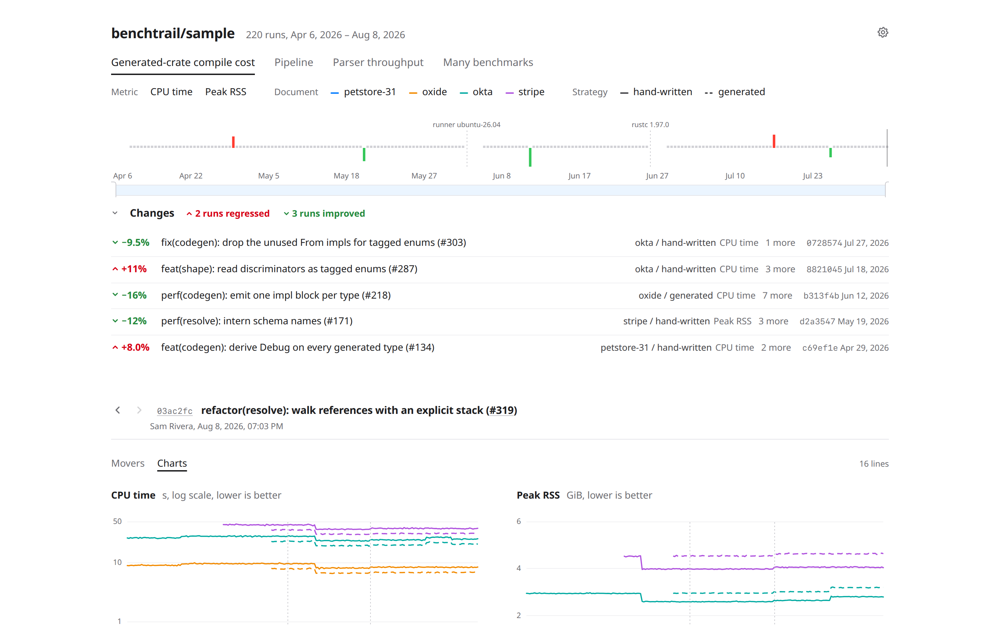

<picture>
  <source media="(prefers-color-scheme: dark)" srcset="docs/hero-dark.png" />
  
</picture>

# benchtrail

benchtrail is a static dashboard for the benchmark history that
[github-action-benchmark](https://github.com/benchmark-action/github-action-benchmark) commits to a
project's GitHub Pages branch.
It reads the action's `data.js` as is, splits each benchmark into named dimensions and metrics, and
marks the runs where a value regressed or improved.

The page needs no build step and no server code: its files and the history sit side by side.
ECharts loads from jsDelivr.

## Use it

github-action-benchmark writes `data.js` into its `benchmark-data-dir-path` (`dev/bench` by
default) on the Pages branch, and only creates an `index.html` there when none exists.
benchtrail goes into that directory, beside the history.

### With GitHub Actions

The benchtrail action installs the dashboard into the directory and writes its settings there.
A job that runs after the benchmarks checks out the Pages branch, installs the dashboard, and
deploys the result to GitHub Pages, set to publish from Actions:

```yaml
deploy:
  needs: benchmark
  runs-on: ubuntu-latest
  permissions:
    contents: read
    pages: write
    id-token: write
  environment:
    name: github-pages
    url: ${{ steps.deployment.outputs.page_url }}
  steps:
    - uses: actions/checkout@v7
      with:
        ref: gh-pages
    - uses: romnn/benchtrail@v0.1.0
      with:
        path: dev/bench
        settings: |
          { "title": "My project benchmarks" }
    - uses: actions/upload-pages-artifact@v5
      with:
        path: .
    - id: deployment
      uses: actions/deploy-pages@v5
```

The Pages branch keeps only the history, and every deploy installs the dashboard of the pinned
release.
A deploy from Actions is also what publishes a push made with `GITHUB_TOKEN`, which does not start
a branch-based Pages build.

| Input      | Default     | Meaning                                                                                                                               |
| ---------- | ----------- | ------------------------------------------------------------------------------------------------------------------------------------- |
| `path`     | `dev/bench` | The directory that holds the history. The dashboard's files are replaced there; the history and any other file stay.                 |
| `settings` |             | The [settings](#settings) as a JSON object, written to `benchtrail.json`. Without it, the directory keeps the settings it has. |

Settings that break a rule fail the step before anything is written, and a directory without
`data.js` is installed with a warning.
Pin an exact release: before 1.0, a minor release may change the settings.
Dependabot or Renovate can keep the pin current.

### By hand

Put benchtrail's files into the directory:

```sh
git switch gh-pages
curl -fsSL -o /tmp/benchtrail.zip https://github.com/romnn/benchtrail/releases/latest/download/benchtrail.zip
unzip -o /tmp/benchtrail.zip -d dev/bench
git add dev/bench && git commit -m "Add the benchtrail dashboard" && git push
```

The archive holds `index.html`, `benchtrail.css`, `benchtrail.js`, and the `benchtrail/` directory
of modules it loads.
To upgrade later, replace all of them, since a release may change the page's markup and its pinned
ECharts build.
Your settings live in `benchtrail.json`, which the archive does not hold, so an upgrade leaves them
as they are.

### Settings

`benchtrail.json` beside `index.html` configures the page.
Every key is optional, and without the file the defaults apply:

```json
{
  "title": "My project benchmarks",
  "threshold": 0.05,
  "names": "^(?<document>[^.]+)\\.(?<strategy>\\S+) (?<metric>.+)$",
  "label": "{{document}} / {{strategy}}",
  "metrics": { "cpu": { "label": "CPU time", "direction": "lower" } },
  "suites": { "Throughput": { "colorBy": "parser" } }
}
```

- `title` replaces the heading, which defaults to the repository name from the history.
- `dataUrl` points at the history script, `data.js` by default.
  A `?data=` query parameter overrides it with a same-origin path to a `.js` file, made of letters,
  digits, `_`, `.`, `/` and `-`.
- `threshold` is the smallest relative change that can count as a regression or an improvement,
  `0.05` by default.
  A shift must also stand out from the benchmark's own noise; see [Detecting changes](#detecting-changes).

The remaining keys apply to every suite at the top level, or to one suite under `"suites"`:

- `names` is a regular expression whose named groups read dimensions out of an untyped benchmark
  name; a group called `metric` names the metric.
- `label` is a template for a benchmark's label.
- `metrics` maps a metric id to `{ "label", "direction": "lower" | "higher", "unit" }`.
- `dimensions` maps a dimension name to `{ "label", "order" }`; dimensions with a lower `order`
  come first.
- `colorBy` and `dashBy` name the dimension that colors or dashes the lines by default.
- `ignoreEnvironment` lists environment names whose changes still allow comparing runs.
- `smoothing` is the default smoothing window in runs: `0` (off, the default), `5`, `11` or `21`.
  Charts then draw the rolling median as a line over the raw values.

A value that breaks these rules, or a key that is not a setting, is left out and listed among
each affected suite's problems, so the page still draws with the rest.

### Links

Every view is a link: the suite, section, filters, zoom window, and selected run live in the query
string, so the address bar can be shared as it is.
Only the theme stays out of it, as a choice remembered in the reader's browser.

"All runs" opens a page that lists every run, with a search, a sort by any line's change, and a way
back to each run in the charts.
A chart's title opens that chart on a page of its own, as `?chart=<metric>:<dimensions>`.
Both open in place: Back returns to the earlier view, and the Overview link keeps the filters,
window, and run chosen on the page.

## Typed benchmarks

Without configuration, a benchmark's name is its only dimension.
A producer can describe each entry precisely instead, through the `extra` string that
github-action-benchmark's custom tools store with every value.
benchtrail reads `extra` as JSON with a `benchtrail` key, version 1:

```json
{
  "name": "petstore/generated cpu",
  "unit": "s",
  "value": 0.518,
  "extra": "{\"benchtrail\":{\"version\":1,\"dimensions\":{\"document\":\"petstore\",\"strategy\":\"generated\"},\"metric\":{\"id\":\"cpu\",\"label\":\"CPU time\",\"direction\":\"lower\"},\"environment\":{\"rustc\":\"1.97.0\"}},\"text\":\"rustc 1.97.0\"}"
}
```

Inside `benchtrail`:

| Key                | Required | Meaning                                                                                                                                                                                                                      |
| ------------------ | -------- | ---------------------------------------------------------------------------------------------------------------------------------------------------------------------------------------------------------------------------- |
| `version`          | yes      | Always `1`. Other versions are reported, not guessed at.                                                                                                                                                                     |
| `metric.id`        | yes      | A non-empty string naming what was measured. The entry's `unit` stays the unit.                                                                                                                                              |
| `metric.label`     | no       | The metric's display name.                                                                                                                                                                                                   |
| `metric.direction` | no       | `"lower"`, `"higher"` or `"unknown"`. Without it, the `metrics` setting or the github-action-benchmark tool decides.                                                                                                         |
| `dimensions`       | no       | Names mapped to strings, finite numbers or booleans. With the metric, they identify the benchmark; `4` and `"4"` differ.                                                                                                     |
| `environment`      | no       | Names mapped to the same scalar types, such as a compiler version. A change starts a new segment, so no verdict compares across it. |
| `benchmarkId`      | no       | A non-empty string that keeps one benchmark's history together while its dimensions change.                                          |

A run records each benchmark once per metric: one value per set of dimensions, or per
`benchmarkId` when one is given.
Variants measured side by side in one run, such as the same benchmark on two operating systems,
belong in `dimensions`, not in `environment`; entries that differ only in their environment are
reported as duplicates and only the first is kept.

An optional `text` string next to `benchtrail` appears as a note on the selected run.
Unknown keys are ignored, so later additions stay readable.
A payload that fails these rules is shown on its own under its name and listed among the page's
problems, so it never merges into a valid history.

## Detecting changes

benchtrail compares each value with the median of up to 20 earlier values of the same benchmark,
counted from the start of its segment or from the last detected change, and needs at least 8 of
them.
A run is marked as a regression or an improvement when the median of it and the next two values
moves beyond both `threshold` and four times the noise expected for that comparison, estimated from
the earlier values' median absolute deviation.
The run itself must also move that far in the same direction, so a step is marked once, at the run
that started it, and a lone outlier that returns to normal is never marked.
Each of those runs must also lie beyond all but one of the earlier values, so noise that alternates
between a few levels does not read as a change.
A change at one of the last two runs is shown as unconfirmed until later runs confirm it.

## Development

[mise](https://mise.jdx.dev) installs the tools pinned in `mise.toml` and `mise.lock`; run
`mise install` once.
The site itself has no dependencies: Node, pnpm and the packages in `package.json` exist only for the
checks and scripts below.

| Command                  | What it does                                                                                    |
| ------------------------ | ----------------------------------------------------------------------------------------------- |
| `task serve`             | Serves the repository at http://127.0.0.1:8765; open `/site/?data=../sample/data.js`.           |
| `task samples`           | Regenerates `sample/data.js` and `sample/edge-cases.js`. `task samples -- 500` writes 500 runs. |
| `task lint`              | Lints and checks formatting with Biome. `task fix` applies the safe fixes and formats.          |
| `task format`            | Formats with Biome.                                                                             |
| `task check`             | Type-checks the JavaScript with TypeScript, using JSDoc where present.                          |
| `task test`              | Runs the Node tests: sample generators, preview server, ECharts version and integrity pin.      |
| `task spellcheck`        | Runs typos.                                                                                     |
| `task lint:actions`      | Runs actionlint on the workflows.                                                               |
| `task screenshot`        | Captures `docs/hero.png` and `docs/hero-dark.png`. Run `task screenshot:setup` once first.      |
| `task screenshot:docker` | The same capture inside the Playwright container, for fonts that do not depend on the machine.  |
| `task outdated`          | Lists dependency updates, respecting the 14-day cooldown in `cooldown.toml`.                    |

`sample/edge-cases.js` collects the irregular data real histories contain; open it with
`?data=../sample/edge-cases.js`.

`site/benchtrail.js` loads the history and draws the page the link opens.
The modules it loads keep the browser at the edge:

- `benchtrail/core/` reads the settings and the history, detects changes, reads and writes links,
  and builds the view and chart options; it touches no browser API, so the Node tests cover it
  directly.
- `benchtrail/regions/` draws each part of a page, such as the header, the charts, or the run list.
- `benchtrail/chart-runtime.js` owns the ECharts instances and syncs zoom and hover between them.

`action.yml` and `action/` are the GitHub Action.
It installs `site/` as the tag holds it and checks the settings with the page's own reader, so it
needs no packages and no build.

### Releasing

`bumpversion minor` (or `patch`, `major`) commits the version, with the action version the README
shows, and creates a `v*` tag.
Pushing the tag runs the tests and the lint, and publishes a GitHub release with `benchtrail.zip`,
which packs `site/` as committed at the tag.
The tag is also the action's version, as `romnn/benchtrail@v<version>`.
